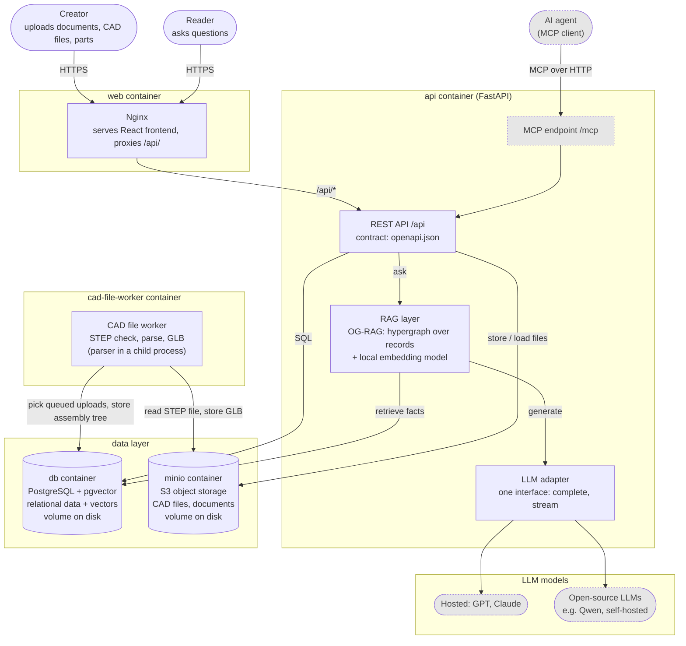
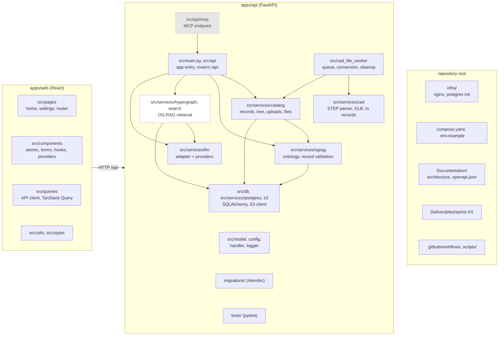

# Engineering Knowledge Advisor - Software Architecture

AMOS WS 2026/27, Team 02 - Sprint 02

## 1. Runtime Overview

Components at runtime and who calls whom. **Solid** boxes are decided
components, **dotted grey**
boxes are options the team has not decided yet.

**Main flows**

- **Upload (Creator):** frontend → `/api` registers CAD file and signs an upload form → browser uploads file straight to MinIO → CAD file worker checks and parses it in the background → assembly tree stored as records in PostgreSQL, 3D model (GLB) in MinIO → records indexed into the OG-RAG hypergraph with the local embedding model (planned).
- **Question (Reader or Agent):** frontend or MCP → `/api` → RAG layer finds the closest facts in the hypergraph (pgvector, pg_trgm) → LLM adapter sends question + facts to the selected model → answer citing its facts, or a refusal.

## 2. Code Overview

Repository folders and backend modules. **Solid** boxes exist in the code
today, **dashed** boxes are decided modules that are not created yet (planned
location), **dotted grey** boxes depend on open decisions. Arrows inside the
backend show which module calls which.

| Folder          | Content                                                                                             |
|-----------------|-----------------------------------------------------------------------------------------------------|
| `apps/web`      | React single-page app, built by Vite, served by Nginx                                               |
| `apps/api`      | FastAPI service and CAD file worker: routers, CAD parser, RAG, LLM adapter, data access, migrations |
| `infra`         | Nginx and PostgreSQL configuration used by Docker Compose                                           |
| `Documentation` | Architecture, API conventions, OpenAPI contract                                               |
| `Deliverables`  | Sprint deliverables (PDFs, images)                                                                  |

## 3. Technology Stack

Language and framework per component. Exact versions are deliberately not
listed here so this page does not go out of date; they are pinned in
`package-lock.json`, `uv.lock`, the Dockerfiles and `compose.yaml`. *In use*
means part of the current setup, *planned* means decided but not implemented,
*open* means not decided yet.

| Component               | Language   | Framework / Product                                                                 | Status    |
|-------------------------|------------|-------------------------------------------------------------------------------------|-----------|
| Frontend                | TypeScript | React                                                                               | in use    |
| Frontend build          | TypeScript | Vite                                                                                | in use    |
| Frontend styling        | CSS        | Tailwind CSS                                                                        | in use    |
| UI components           | TypeScript | shadcn components (copied into the repo) on Base UI                                 | in use    |
| Frontend data / routing | TypeScript | TanStack Query / Router / Form, Zod                                                 | in use    |
| Frontend tests          | TypeScript | Vitest                                                                              | in use    |
| Web server              | -          | Nginx                                                                               | in use    |
| Backend                 | Python     | FastAPI, Uvicorn                                                                    | in use    |
| Validation / config     | Python     | Pydantic, pydantic-settings                                                         | in use    |
| Data access             | Python     | SQLAlchemy, psycopg                                                                 | in use    |
| DB migrations           | Python     | Alembic                                                                             | in use    |
| Object storage client   | Python     | boto3                                                                               | in use    |
| Backend tests           | Python     | pytest                                                                              | in use    |
| Python packaging        | -          | uv                                                                                  | in use    |
| Relational + vector DB  | SQL        | PostgreSQL + pgvector                                                               | in use    |
| Object storage          | -          | MinIO (S3 API)                                                                      | in use    |
| API contract            | JSON       | OpenAPI (`Documentation/openapi.json`), exported from FastAPI                       | in use    |
| LLM adapter             | Python     | provider-neutral chat and streaming interface                                       | in use    |
| LLM model               | -          | configured per provider and request                                                 | in use    |
| CAD parser              | Python     | Open CASCADE (`cadquery-ocp`)                                                       | in use    |
| RAG approach            | Python     | ontology-grounded RAG, [`knowledge-retrieval.md`](knowledge-retrieval.md)           | *planned* |
| Embedding model         | -          | `intfloat/multilingual-e5-base`, [`knowledge-retrieval.md`](knowledge-retrieval.md) | *planned* |
| Agent access            | Python     | MCP endpoint `/mcp`                                                                 | *open*    |
| Containers / CI         | -          | Docker Compose, GitHub Actions                                                      | in use    |

## 4. Explanation and Design Decisions

**Runtime (page 1).** Creators and Readers use the React frontend in the
browser. Nginx serves the frontend and forwards `/api/*` to the backend, so
both share one origin and no CORS setup is needed. The FastAPI backend is the
single entry point for all business logic: it stores files in MinIO, reads and
writes PostgreSQL directly, queues uploaded CAD files for the CAD file worker,
and answers questions through the RAG layer and the LLM adapter. AI agents may later use the same
functions through an MCP endpoint, which reuses the REST services instead of
duplicating them. The REST API is described by an OpenAPI file exported from
FastAPI; it is the contract between frontend and backend.

**Code (page 2).** The repository is a monorepo with one folder per deployable
app under `apps/`. Inside the backend each concern has its own module
(routers, CAD parsing, RAG, LLM adapter, data access), so a module can be
replaced or tested on its own. Deployment configuration lives in
`compose.yaml` and `infra/`, documentation and deliverables in their own
folders.

**Main choices**

- **pgvector instead of a separate vector database.** Embeddings live in the
  same PostgreSQL database as the parts and documents they belong to. One query
  can combine filters (part, project, document type) with similarity search,
  data stays consistent in one transaction, and there is one database to run
  and back up. LanceDB was considered; we can switch later if vector volume or
  speed requires it.
- **LLM adapter so Bosch can switch providers.** The backend calls one internal
  interface instead of a vendor SDK. Each provider - hosted
  models such as GPT or Claude, or open-source models such as Qwen running on
  Bosch's own hardware - is one implementation selected by configuration.
  Bosch can change the model for cost, data-protection or quality reasons
  without changing the rest of the code, and tests can use a fake provider.
  Embeddings do not go through it: the embedding model runs locally in the
  backend.
- **OG-RAG on a knowledge hypergraph over generic domain records.**
  [`knowledge-retrieval.md`](knowledge-retrieval.md). The layer sits behind its
  own module, so it does not affect the frontend or the API.
- **CAD files processed by a worker, STEP first.** A separate `cad-file-worker`
  container picks uploaded files from a queue in PostgreSQL, so large files
  never block the API. It parses each file with Open CASCADE in a child process,
  so a crash or hang of the C++ library does not kill the worker, imports the
  assembly tree as records and stores a 3D model (GLB) for the viewer.
  STEP (ISO 10303) is the vendor-neutral format all major CAD tools
  export, with open-source parsers. Other formats can be added as further
  parsers.
- **MinIO for files.** CAD files and documents are large binaries and do not
  belong in the database. MinIO speaks the S3 API, so the same code works with
  any S3-compatible storage at Bosch. All data lives in Docker volumes on disk.
- **FastAPI + React.** Python gives direct access to CAD, embedding and LLM
  libraries; FastAPI validates requests and generates the OpenAPI contract.
  React with TypeScript gives a typed, component-based UI.
- **Nginx instead of a Node.js server for the frontend.** The React app is a
  single-page app without server-side rendering, so the Vite build produces
  only static files. Node.js is used only in the build stage of the Docker
  image; the running container is Nginx, which serves static files fast,
  needs little memory and has a small attack surface. The same Nginx also
  forwards `/api/*` to the backend, so no extra proxy is needed.
